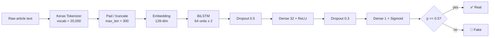

<div align="center">

# 📰 Fake News Detector

**A Bidirectional LSTM text classifier that labels news articles as _Real_ or _Fake_ — with a training notebook, a pretrained model, and a live Streamlit app.**

[](https://fake-news-detector-mahan-liaghatmand.streamlit.app/)
[](https://www.python.org/)
[](https://www.tensorflow.org/)
[](LICENSE)
[](#-known-limitations)

[Live Demo](https://fake-news-detector-mahan-liaghatmand.streamlit.app/) · [Quick Start](#-quick-start) · [Model](#-model-architecture) · [Limitations](#-known-limitations) · [Roadmap](#-roadmap)

</div>

---

## 📖 Overview

This project trains a deep learning model on **5,829 labeled news articles** to distinguish genuine reporting from fake news. Article text is tokenized, converted to fixed-length sequences, and passed through an **Embedding → Bidirectional LSTM** network that outputs the probability that an article is real.

Everything needed to reproduce and use the model is included: the dataset, the training notebook, the trained artifacts, a Streamlit web app, and a written project report.

> [!WARNING]
> **The reported ~99.7% accuracy is inflated by dataset leakage.** The model largely learns to detect wire-service formatting (e.g. `CITY (Reuters) -`) rather than misinformation itself. Please read [Known Limitations](#-known-limitations) before drawing any conclusions from the metrics.

## ✨ Features

- 🧠 **Bidirectional LSTM** classifier built with TensorFlow / Keras
- 🔤 **Simple preprocessing pipeline** — tokenization (20k vocab, `<OOV>` handling) and sequence padding (max length 300)
- 🖥️ **Interactive Streamlit app** — paste an article, get a verdict plus a confidence score
- 📦 **Pretrained artifacts included** — run the app without retraining
- 📓 **Reproducible notebook** covering training, evaluation, and export
- 🔍 **Transparent reporting** — data-quality audit and known issues documented, not hidden

## 🧩 Pipeline



## 🏗️ Model Architecture

| Layer | Output Shape | Params |
|---|---|---:|
| Embedding (vocab 20,000, dim 128) | (None, 300, 128) | 2,560,000 |
| Bidirectional LSTM (64 units) | (None, 128) | 98,816 |
| Dropout (0.5) | (None, 128) | 0 |
| Dense (32, ReLU) | (None, 32) | 4,128 |
| Dropout (0.3) | (None, 32) | 0 |
| Dense (1, Sigmoid) | (None, 1) | 33 |
| **Total** | | **2,662,977** |

**Training setup:** Adam optimizer · Binary Crossentropy loss · up to 5 epochs · Early Stopping (patience 3, best weights restored) · 80/20 train/test split (4,663 / 1,166 samples).

## 📊 Results

Evaluated on the 20% held-out split (1,166 articles). Label convention: `1 = Real`, `0 = Fake`.

| Metric | Train | Test |
|---|---:|---:|
| Accuracy | 100.00% | 99.66% |
| Precision | — | 99.50% |
| Recall | — | 99.83% |

**Confusion matrix (test set)**

|  | Predicted Fake | Predicted Real |
|---|---:|---:|
| **Actual Fake** | 562 | 3 |
| **Actual Real** | 1 | 600 |

> These numbers describe performance **on this specific dataset**, including its leakage. They should not be read as real-world detection accuracy.

## 🗂️ Project Structure

```
Fake-news-detector/
├── Dataset/
│   └── news_dataset.csv              # 5,829 labeled articles (x = text, y = label)
├── Model/
│   ├── News_Fake_Detection.ipynb     # Training & evaluation notebook
│   ├── model.pkl                     # Trained Keras BiLSTM model
│   └── Tokenzier.pkl                 # Fitted Keras Tokenizer
├── app.py                            # Streamlit web application
├── requirements.txt                  # Python dependencies
├── Fake_News_Detection_Report.pdf    # Full project report
└── LICENSE
```

## 🚀 Quick Start

### 1. Clone and install

```bash
git clone https://github.com/<your-username>/Fake-news-detector.git
cd Fake-news-detector

python -m venv .venv
source .venv/bin/activate        # Windows: .venv\Scripts\activate

pip install -r requirements.txt
```

### 2. Run the app

```bash
streamlit run app.py
```

Open the local URL Streamlit prints (usually `http://localhost:8501`), paste an article or pick a built-in example, and click **Analyze**.

### 3. Use the model from Python

```python
import pickle
import numpy as np
from tensorflow.keras.preprocessing.sequence import pad_sequences

with open("Model/model.pkl", "rb") as f:
    model = pickle.load(f)
with open("Model/Tokenzier.pkl", "rb") as f:
    tokenizer = pickle.load(f)

text = "WASHINGTON (Reuters) - U.S. lawmakers said on Tuesday ..."
seq = pad_sequences(tokenizer.texts_to_sequences([text]), maxlen=300,
                    padding="post", truncating="post")

p_real = float(np.ravel(model.predict(seq, verbose=0))[0])
print("Real" if p_real >= 0.5 else "Fake", f"(p_real={p_real:.3f})")
```

### 4. Retrain

Open `Model/News_Fake_Detection.ipynb` in Jupyter or Google Colab. The notebook currently reads the dataset from Google Drive; change the path to `Dataset/news_dataset.csv` to run it locally.

> [!NOTE]
> `max_len` (300), `padding`/`truncating` (`post`) and the tokenizer must stay identical between training and inference.

## ⚠️ Known Limitations

The data-quality audit documented in the [project report](Fake_News_Detection_Report.pdf) found several issues that make the headline metrics misleading:

1. **Wire-service leakage.** 99.6% of articles labeled *Real* contain the word "Reuters", versus only 1.8% of *Fake* articles. The model can reach near-perfect accuracy by spotting agency datelines instead of analyzing content or style.
2. **Test set doubles as validation set.** The notebook passes the test split as `validation_data` for early stopping, so best-epoch selection is informed by the data used for the final score. The test estimate is therefore slightly optimistic even before accounting for leakage.
3. **Unseeded, non-stratified split.** `train_test_split` is called without `random_state` or `stratify`, so results vary between runs and are not exactly reproducible.
4. **Single-source, narrow-domain data.** Articles appear to come from a small number of publishers and a limited time window, so generalization to other outlets, topics, or recent events is untested.
5. **Style classifier, not a fact-checker.** The model never verifies claims. It learns writing patterns and formatting only.
6. **Pickle-based artifacts.** `model.pkl` and `Tokenzier.pkl` are loaded with `pickle`, which can execute arbitrary code. Only load pickle files from sources you trust.

## 🗺️ Roadmap

**Fixing the leakage (highest priority)**

- [ ] Strip agency names, datelines, and boilerplate (`(Reuters) -`, `Reuters`, etc.) in a reusable cleaning step
- [ ] Retrain on the cleaned text and report leakage-free metrics next to the current ones
- [ ] Add an ablation experiment: with vs. without agency tokens
- [ ] Split into **train / validation / test**, using `stratify=y` and a fixed `random_state`
- [ ] Evaluate on out-of-distribution articles (different publishers and dates)

**Modeling**

- [ ] Add a TF-IDF + Logistic Regression baseline for honest comparison
- [ ] Try pretrained transformers (e.g. DistilBERT, RoBERTa) via Hugging Face
- [ ] Add cross-validation and report confidence intervals
- [ ] Add precision-recall / ROC curves and calibration analysis

**Engineering**

- [ ] Replace `pickle` with the native Keras format (`.keras`) and `tokenizer.to_json()`
- [ ] Move training code from the notebook into a reusable `src/` package with a CLI
- [ ] Add unit tests and a GitHub Actions CI workflow
- [ ] Add a Dockerfile for one-command deployment
- [ ] Pin exact dependency versions

**App**

- [ ] Highlight the words that most influenced the prediction (LIME / SHAP / attention)
- [ ] Show a warning when input text is very short or non-English
- [ ] Add batch prediction from an uploaded CSV

## 🛠️ Tech Stack

| Area | Tools |
|---|---|
| Language | Python |
| Deep learning | TensorFlow / Keras (Embedding, Bidirectional LSTM) |
| ML utilities | scikit-learn (split, metrics) |
| Data | pandas, NumPy |
| Visualization | Matplotlib |
| Web app | Streamlit |

## 📄 Project Report

[`Fake_News_Detection_Report.pdf`](Fake_News_Detection_Report.pdf) covers the split strategy, the data-quality and leakage audit, the architecture, validation results with the confusion matrix, training curves, and recommendations.

## 🤝 Contributing

Contributions are welcome, especially on the [Roadmap](#-roadmap) items.

1. Fork the repository
2. Create a branch: `git checkout -b feature/your-feature`
3. Commit your changes: `git commit -m "Add your feature"`
4. Push the branch and open a Pull Request

## ⚖️ Disclaimer

This project is for **educational and demonstration purposes only**. Because of the data leakage described above, it must **not** be used as an authoritative fake-news detector. Always verify news through trusted, independent sources.

## 📜 License

Released under the [MIT License](LICENSE). © 2026 Mahan Liaghatmand.

---

<div align="center">

If this project helped you, consider giving it a ⭐

</div>
